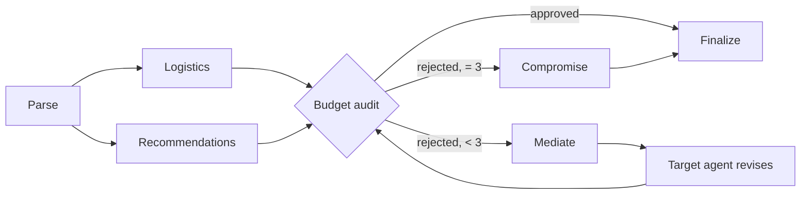

# Roamly — Product Context

Last updated: 2026-10-02 (Phase 1). Companion to `docs/workflow.md` (architecture) and `docs/audit.md` (state of the old code).

---

## 1. Problem statement

Planning a trip means satisfying several constraints that pull against each other: the route has to be physically possible, the experience has to be worth it, and the total has to fit a fixed budget. People do this by hopping between flight sites, hotel sites, maps and a spreadsheet.

A single LLM asked to "plan 4 days in Tokyo for $2000" tends to produce a pleasant itinerary that quietly ignores one of those constraints. It invents prices, forgets the budget halfway through, or schedules a museum two hours after a red-eye lands.

Roamly splits the job between four agents with deliberately opposing priorities. They work on one shared, typed plan and negotiate until the plan passes a budget check done with real arithmetic. The user watches the negotiation live and gets an itinerary that either fits the budget or says plainly by how much it does not.

## 2. Target users

- **Budget-bound travellers** (students, young professionals) who have a hard number and want the best trip inside it.
- **People who do not enjoy planning** and want one prompt to produce a usable day-by-day plan with links.
- **Evaluators of the project** (faculty, interviewers) who want to see a real multi-agent system: typed state, deterministic routing, tool calling, fallbacks, persistence.

## 3. Why multi-agent beats a single LLM here

| Problem with one LLM | How the multi-agent design answers it |
|---|---|
| **Context dilution.** One prompt has to hold geography, taste, prices and arithmetic. Something gets dropped. | Each agent sees only the slice of state it needs and has one job. |
| **No stress test.** The model grades its own homework. | The Budget agent exists only to reject. Its verdict comes from a calculator, not from the model's opinion. |
| **Invented data.** Prices and flight numbers are recalled, not looked up. | Agents can only propose items returned by tools. IDs are validated against tool results before they enter state. |
| **Arithmetic by vibes.** | Totals are computed in code. The LLM never adds numbers. |
| **No termination guarantee.** A "debate" can run forever or stop early. | The graph has fixed edges, a hard cap of 3 rejections, and a Compromise node. |
| **Opaque result.** | Every proposal, rejection and revision is an event the user can read and that is stored. |

## 4. The four agents

All agents share these rules: they read and write the shared `TripState`; they get models only from the `llm` module; they may only reference options that came back from a tool; every LLM output is parsed with a Zod schema, and a failed parse is retried once and then handled by a deterministic fallback that is clearly flagged in the event stream.

### 4.1 Supervisor / Negotiator — "the Executive"

| | |
|---|---|
| **Goal** | Turn a free-text request into a final, structured, linkable itinerary, and keep the negotiation moving to a conclusion. |
| **Persona** | Calm chair of the meeting. Neutral, brief, decisive. |
| **System-prompt intent** | Parse precisely and record every assumption. When Budget rejects, pass the exact numeric constraint to the right agent. Never invent options or numbers. At the end, schedule the approved items into days that respect arrival and departure times. |
| **Tools** | None that touch the outside world. Uses `calculate_trip_cost` output and state. Geocoding of the destination happens through `geocode_place` during parsing. |
| **Reads** | `rawRequest`, `structuredHints`, user preferences; later the whole state. |
| **Writes** | `request` (parsed), `assumptions`, `negotiation.instruction`, `itinerary`, `status`. |
| **Model role** | `reasoning` for parse and finalize. Mediation text is built from the Budget verdict by template, with no LLM call. |
| **Acceptance criteria** | Parsed request passes the Zod schema; destination geocodes; dates are in the future and end ≥ start; final itinerary references only IDs present in state; itinerary total equals the calculator's total. |
| **Failure modes** | Ambiguous destination → picks one, records the assumption. Missing budget → asks nothing, assumes a default from the user's budget style and records it. Unparseable request → run ends with a clear error asking the user to rephrase. Finalize output invalid → deterministic day distribution is used and flagged. |

Example:

> **User:** "4 days in Tokyo, $2000 budget"
> **Supervisor:** "Parsed: Tokyo, 4 days / 3 nights, 1 traveller, USD 2000. Assumptions: departing from Mumbai (your home city); dates set 5 weeks out because none were given."

### 4.2 Logistics — "the Realist"

| | |
|---|---|
| **Goal** | A physically possible way to get there and back, and realistic travel times on the ground. |
| **Persona** | A dispatcher. Cares about hours, layovers and distance. Indifferent to price. |
| **System-prompt intent** | Rank by convenience and feasibility only. Flag layovers under 60 minutes and arrivals between midnight and 06:00. State price as data, never sort by it on the first pass. On a revision, treat the price ceiling as a hard filter, then rank what is left by convenience. |
| **Tools** | `search_flights`, `estimate_travel_time`, `geocode_place`. |
| **Reads** | `request` (origin, destination, dates, travellers); on revision `negotiation.instruction`. |
| **Writes** | `flights.candidates` (up to 5), `flights.selectedId`, `flights.notes`, arrival/departure constraints for day 1 and the last day. |
| **Model role** | `worker`. |
| **Acceptance criteria** | Selected flight exists in tool results; duration, stops and arrival time are present; red flags are stated explicitly; on revision the selected price is ≤ the ceiling or the agent reports that none exists. |
| **Failure modes** | No flights returned → reports it; Supervisor ends the run with "no route found for these dates". Every option red-flagged → proposes the least bad and says so. Tool error → retried, then the run pauses as resumable. |

Example:

> **Logistics:** "Proposing the direct flight, 8h 30m, arriving 18:00. The 1-stop option is cheaper but lands at 22:15, which removes day 1. Airport to centre is about 55 minutes."

### 4.3 Local-Recommendations — "the Dreamer"

| | |
|---|---|
| **Goal** | The version of the trip the traveller would be excited about: where to stay, what to do, where to eat. |
| **Persona** | A well-travelled friend. Optimistic, specific, quality-first. |
| **System-prompt intent** | First pass: best-rated stay in the best-fitting neighbourhood and activities matching stated interests. It is expected that this may be rejected on cost. On a revision: apply the numeric ceiling as a filter before ranking, never re-propose something over it, and say in one sentence how the new pick satisfies the constraint. |
| **Tools** | `search_hotels`, `search_places`, `get_weather`, `web_search` (context only, never prices). |
| **Reads** | `request`, user preferences (interests, pace, food), `negotiation.instruction`; `flights` arrival info when available. |
| **Writes** | `stay.candidates`, `stay.selectedId`, `activities.candidates`, `activities.selectedIds`, `weather`, a short justification. |
| **Model role** | `worker`. |
| **Acceptance criteria** | Every selected item exists in tool results; 3–5 activities per trip scaled by days and pace; on revision the nightly price or activity spend is ≤ the ceiling. |
| **Failure modes** | Nothing under the ceiling → reports the cheapest available and its price so Budget can retarget. Sparse data for a small town → fewer activities, flagged. LLM returns an unknown ID → that item is dropped and the best-ranked valid candidate is used. |

Example:

> **Recommendations (round 2):** "Switched to a boutique hotel in the same area at $150/night, under the $165 ceiling. Kept all four activities."

### 4.4 Budget — "the Skeptic"

| | |
|---|---|
| **Goal** | Decide whether the current plan fits the budget, and if not, name one concrete constraint that fixes the biggest problem. |
| **Persona** | An auditor. No opinions about taste. Never approves out of politeness. |
| **System-prompt intent** | You do no arithmetic. Quote only numbers from the calculator result. If rejecting, name the category, the ceiling, and the amount over. |
| **Tools** | `calculate_trip_cost` (deterministic), `convert_currency`. |
| **Reads** | Selected flight, stay, activities, `request.budget`, traveller count, nights. |
| **Writes** | `budget.breakdown`, `budget.status`, `budget.target`, `budget.ceiling`, `budget.overBy`, `budget.feedback`, and one row in the audit history. |
| **Model role** | `fast`, used only to word the feedback. The verdict, target and ceiling are computed in code. If the model is unavailable the templated sentence is used. |
| **Acceptance criteria** | `status` is `approved` exactly when `total ≤ budget`; every number in the feedback appears in the breakdown; a rejection always carries a numeric ceiling and a target agent. |
| **Failure modes** | Mixed currencies → everything is converted to the trip currency first; a failed FX lookup pauses the run rather than guessing. Missing price on an item → the item is treated as unpriced and flagged; the plan cannot be approved with unpriced flights or stay. |

How the target is chosen (deterministic): for each category, savings potential = current cost − cheapest known alternative among the candidates already in state. The category with the largest potential is targeted. Hotel and activities go to Recommendations; flights go to Logistics. Food and local transport are estimates and are not negotiable.

Example:

> **Budget:** "Rejected. Total is $2,460 against $2,000, over by $460. Stay is 39% of cost. Need accommodation at or under $165/night."

## 5. Shared state (`TripState`)

Defined once with Zod in `src/orchestrator/state.ts`. This is the blackboard. Field by field:

| Field | Type | Written by | Meaning |
|---|---|---|---|
| `runId`, `tripId`, `userId` | uuid | entry | Identity. `runId` is also the checkpoint `thread_id`. |
| `rawRequest` | string | entry | The user's prompt, unchanged. |
| `structuredHints` | object, all optional | entry | Optional form fields: origin, dates, travellers, budget, currency, interests, pace. They override what the parser infers. |
| `preferences` | object | entry | From the user's profile: home city, currency, budget style, interests, pace, dietary notes. |
| `request` | `ParsedRequest` | Supervisor | Destination (name, country, lat/lng), origin, `startDate`, `endDate`, `nights`, `travellers`, `budget` `{amount, currency}`, `interests[]`. |
| `assumptions` | string[] (append) | any | Everything that was guessed. Shown to the user. |
| `flights` | `{ candidates[], selectedId, notes, arrival, departure }` | Logistics | Options returned by the flight tool and the current pick. |
| `stay` | `{ candidates[], selectedId, notes }` | Recommendations | Hotel options and the current pick. |
| `activities` | `{ candidates[], selectedIds[] }` | Recommendations | Places and experiences. |
| `weather` | daily summary[] | Recommendations | Used for scheduling outdoor items. |
| `estimates` | `{ foodPerDay, localTransportPerDay }` | Budget | Per-person daily estimates for the destination, with their source. |
| `budget` | `{ status, breakdown, target, ceiling, overBy, feedback }` | Budget | `status` is `pending`, `approved`, `rejected` or `compromise`. `breakdown` has flights, stay, activities, food, localTransport, total and percentages. |
| `negotiation` | `{ round, rejections, maxRejections, instruction }` | Budget / Supervisor | Loop control. `instruction` is the typed constraint handed to the target agent: `{ target, category, ceiling, currency }`. |
| `audits` | `BudgetAudit[]` (append) | Budget | History of every verdict. |
| `itinerary` | `FinalItinerary` | Supervisor | Days, items with times, costs, coordinates and deep links, totals, `fitsBudget`, markdown. |
| `usage` | `{ llmCalls, toolCalls }` (sum) | llm / tools | Per-run request budget. |
| `status` | enum | graph | `running`, `completed`, `completed_over_budget`, `failed`, `paused`. |
| `error` | `{ code, message }` optional | graph | User-facing reason when paused or failed. |

Reducers: `assumptions` and `audits` append; `usage` sums; everything else is last-write-wins. Logistics and Recommendations write disjoint keys, which is what makes running them in parallel safe.

Each option (flight, hotel, place) carries `id`, `provider`, `price {amount, currency}`, coordinates where relevant, `deepLink`, and `fetchedAt`.

## 6. The negotiation loop, worked example

Request: **"4 days in Tokyo, $2000 budget."** Numbers below are illustrative, chosen to show the mechanics.

**Parse.** Supervisor produces: Tokyo, 3 nights, 1 traveller, USD 2000, origin Mumbai (from profile), dates 5 weeks out. Two assumptions recorded.

**Round 0 — parallel proposals.**

- Logistics: direct flight, $780 return, arrives 18:00.
- Recommendations: hotel at $320/night, four activities totalling $420.

**Audit 1.** Budget runs the calculator:

| Category | Amount |
|---|---|
| Flights | $780 |
| Stay (3 × $320) | $960 |
| Activities | $420 |
| Food (4 days × $60) | $240 |
| Local transport (4 days × $15) | $60 |
| **Total** | **$2,460** |

$2,460 > $2,000. **Rejected**, over by $460. Largest savings potential is the stay. Ceiling = (2000 − 780 − 420 − 240 − 60) ÷ 3 = $166, rounded down to **$165/night**.

**Mediation.** Supervisor routes to Recommendations with `{ category: "stay", ceiling: 165, currency: "USD" }`.

**Round 1 — revision.** Recommendations filters candidates to ≤ $165 and picks a boutique hotel at $150/night in the same area. Activities unchanged.

**Audit 2.** 780 + 450 + 420 + 240 + 60 = **$1,950** ≤ $2,000. **Approved**, margin $50.

**Finalize.** Supervisor schedules: day 1 arrival and check-in only (lands 18:00), activities across days 2–3, light morning on day 4 before departure. Output is structured JSON plus a markdown itinerary with links.

**Compromise variant.** Same request with a **$900** budget. After three rejections the cheapest plan the agents found is: 1-stop flight $620, hostel 3 × $60 = $180, free activities only, food $200, transport $60 = **$1,060**. The loop cap is hit, so the graph goes to the Compromise node. It assembles the cheapest feasible combination from all candidates seen, marks the plan `completed_over_budget`, states "over by $160", and lists what would close the gap (raise the budget, drop a night, move dates). The plan is never labelled approved.

## 7. Glossary

| Term | Meaning |
|---|---|
| **Blackboard / shared state** | The single `TripState` object every agent reads and writes. |
| **Run** | One execution of the graph for a trip request. Has a `runId` and a checkpoint thread. |
| **Round** | One pass of proposal → audit. Round 0 is the initial parallel proposal. |
| **Rejection** | A Budget verdict of `rejected`. Three is the cap. |
| **Ceiling** | The numeric limit Budget hands to another agent, e.g. $165/night. |
| **Mediation** | The Supervisor turning a rejection into a typed instruction for one agent. |
| **Compromise** | The node reached after three rejections. Produces the cheapest feasible plan, honestly labelled. |
| **Candidate** | An option returned by a tool. Only candidates may be selected. |
| **Deep link** | A URL to the provider's page where the user can book the option. |
| **Checkpoint** | A saved snapshot of state after each graph step, used to resume. |
| **Role** | A named model slot (`reasoning`, `worker`, `fast`) mapped to an ordered model list in config. |
| **Fallback depth** | How far down the model list a call had to go before it succeeded. |

## 8. Non-goals

- **No real booking or payments.** The product searches, prices and links out. Provider interfaces leave room for a booking provider later.
- **No deployment work.** This is a final-year project run locally. The code avoids choices that would block deployment, and goes no further.
- **No paid LLM usage.** Free OpenRouter models plus a free second provider only.
- **No polished UI yet.** A simple, clean interface for demonstration. Visual polish is a later pass.
- **No automated test suite for now.** Verification is type-check, lint, build and a manual checklist per phase.
- **No group trips with multiple accounts, no visa or insurance advice, no offline mode, no native app.**
- **No agents taking irreversible actions on their own.** Anything that sends or publishes needs an explicit user click.
