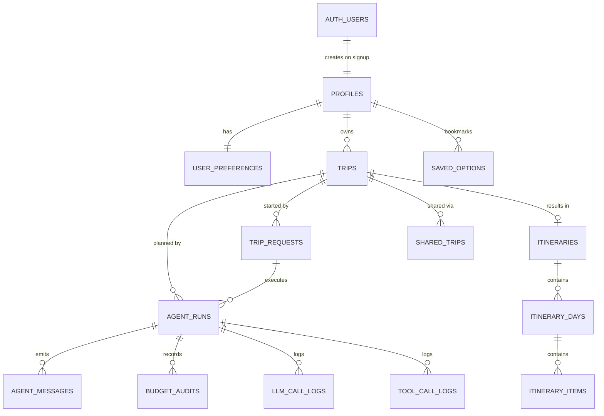

# Roamly — Database

Last updated: 2026-10-02 (Phase 3). Source of truth: `supabase/migrations/`. Types in `src/types/database.ts` are generated from the live schema with `npm run db:types`.

## Commands

| Command | What it does |
|---|---|
| `npm run db:migrate` | Applies every migration not yet recorded in `public.schema_migrations`. Each file runs in one transaction. Safe to re-run. |
| `npm run db:types` | Regenerates `src/types/database.ts` from the database. |

Both read `SUPABASE_DB_URL` from `.env`.

## Migrations

| File | Contents |
|---|---|
| `0001_reset_legacy.sql` | Drops the 4 tables and 2 functions from the old `schema.sql` |
| `0002_core.sql` | Enums, `profiles`, `user_preferences`, `trips`, `trip_requests` |
| `0003_runs.sql` | `agent_runs`, `agent_messages`, `budget_audits` |
| `0004_itinerary.sql` | `itineraries`, `itinerary_days`, `itinerary_items`, `saved_options`, `shared_trips` |
| `0005_observability.sql` | `llm_call_logs`, `tool_call_logs`, `provider_quota_usage`, `tool_cache`, schema `langgraph` |
| `0006_security.sql` | `updated_at` triggers, signup trigger, RLS policies, grants |

## Entity relationships

`provider_quota_usage` and `tool_cache` stand alone.

## Tables

| Table | Purpose | Key columns |
|---|---|---|
| `profiles` | One row per account | `id` = `auth.users.id`, `full_name`, `email`, `onboarded_at` |
| `user_preferences` | Planning defaults | `home_city`, `currency`, `budget_style`, `pace`, `interests[]`, `dietary[]`, `theme` |
| `trips` | The user-facing trip | `destination`, dates, `travellers`, `budget_amount`, `currency`, `total_cost`, `status`, `current_run_id`, `deleted_at` (soft delete) |
| `trip_requests` | The prompt as typed, plus what was parsed | `raw_prompt`, `structured_hints`, `parsed`, `assumptions[]` |
| `agent_runs` | One execution of the graph. `id` is also the checkpoint thread id | `status`, `round`, `rejections`, `llm_calls`, `tool_calls`, `error_code` |
| `agent_messages` | Negotiation transcript | `seq` (unique per run, used for stream replay), `agent`, `kind`, `round`, `content`, `data` |
| `budget_audits` | Every Budget verdict | `status`, `total`, `breakdown`, `target_agent`, `ceiling`, `over_by` |
| `itineraries` | Final plan, one per trip | `total_cost`, `fits_budget`, `over_by`, `cost_breakdown`, `summary_markdown` |
| `itinerary_days` | Days of the plan | `day_number` (unique per itinerary), `date` |
| `itinerary_items` | Flights, stays, activities, meals, transfers | `type`, `position`, times, `cost_amount`, `lat`, `lng`, `deep_link`, `provider`, `external_id` |
| `saved_options` | Bookmarked options | `kind`, `provider`, `external_id`, `payload` |
| `shared_trips` | Read-only share links | `token` (unique, random), `expires_at`, `revoked_at` |
| `llm_call_logs` | One row per LLM call | `provider`, `requested_model`, `served_model`, `fallback_depth`, tokens, `latency_ms`, `status` |
| `tool_call_logs` | One row per tool call | `tool`, `provider`, `latency_ms`, `cache_hit`, `status` |
| `provider_quota_usage` | Requests per provider per UTC day | primary key (`provider`, `day`) |
| `tool_cache` | Cached tool results | `key`, `value`, `expires_at` |

Child tables carry a `user_id` column as well as their parent key. It costs a few bytes per row and makes every policy a single indexed comparison instead of a join.

## Enums

| Enum | Values |
|---|---|
| `trip_status` | draft, planning, ready, over_budget, paused, failed |
| `run_status` | queued, running, paused, completed, completed_over_budget, failed |
| `agent_name` | supervisor, logistics, recommendations, budget, system |
| `message_kind` | info, proposal, rejection, revision, approval, mediation, compromise, final, error |
| `budget_status` | approved, rejected, compromise |
| `item_type` | flight, stay, activity, meal, transfer, note |
| `option_kind` | flight, stay, place |
| `budget_style` | saver, balanced, comfort |
| `travel_pace` | relaxed, balanced, packed |
| `theme_pref` | light, dark, system |
| `call_status` | success, error, timeout, rate_limited |

## Row Level Security

RLS is enabled on all 16 tables. The `anon` role has no access to anything. Privileges for `authenticated` are revoked and then granted per table to match the policies, so a missing policy cannot be bypassed by a leftover default grant.

Every policy is `user_id = auth.uid()` (or `id = auth.uid()` for `profiles`).

| Table | Signed-in owner can | Notes |
|---|---|---|
| `profiles` | select, update | Row is created by the signup trigger |
| `user_preferences` | select, update | Row is created by the signup trigger |
| `trips` | select, insert, update | No delete. Removing a trip sets `deleted_at` |
| `trip_requests` | select, insert | Insert also checks the trip is theirs |
| `agent_runs` | select | Written by the server |
| `agent_messages` | select | Written by the server |
| `budget_audits` | select | Written by the server |
| `itineraries` | select, update | Created by the server at the end of a run |
| `itinerary_days` | select, update | |
| `itinerary_items` | select, insert, update, delete | Editing: swap, move, retime, remove |
| `saved_options` | select, insert, delete | |
| `shared_trips` | select, insert, update | Revoking sets `revoked_at`. The public share page resolves the token on the server; there is no anonymous policy |
| `llm_call_logs` | nothing | Service role only |
| `tool_call_logs` | nothing | Service role only |
| `provider_quota_usage` | nothing | Service role only |
| `tool_cache` | nothing | Service role only |

"Written by the server" means the service-role client in `src/lib/supabase/admin.ts`, used only after the route has verified the user and their ownership of the trip.

## Triggers and functions

| Name | When | What |
|---|---|---|
| `handle_new_user()` | After insert on `auth.users` | Creates the `profiles` and `user_preferences` rows. `security definer`, empty `search_path`, not executable by clients |
| `set_updated_at()` | Before update on tables with `updated_at` | Stamps `updated_at` |

Accounts that existed before the migration get their profile and preference rows from a backfill in `0006`.

## How this was checked

The migrations were applied to a local PostgreSQL 16 with stand-ins for Supabase's `auth` schema and roles, starting from a database that contained the old tables. Results: all six applied, a second run was a no-op, RLS was on for every table, user B saw none of user A's trips, B could not insert a trip as A, `authenticated` could not read log tables, `anon` could not read trips, and a hard delete on `trips` was refused. They have not yet been applied to the real Supabase project.
