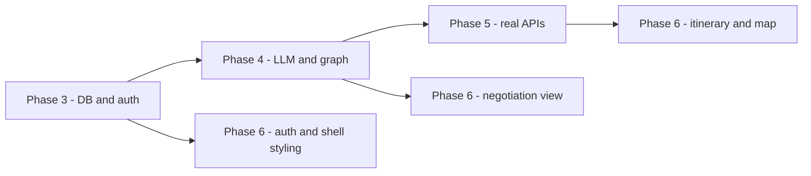

# Roamly — Implementation Plan

Last updated: 2026-10-02 (Phase 2). Reads with `docs/workflow.md` (architecture) and `docs/ux_flow.md` (screens).

Ground rules for every task:

- Small commits on branch `aryan`, one logical unit each.
- No automated test scripts for now (owner's decision). Each task has a **check**: something to run or click that proves it works.
- Done for a phase = `npm run typecheck`, `npm run lint` and `npm run build` pass, migrations apply to a fresh project, `docs/` updated, `.env.example` current, manual checklist handed over.
- Estimates are focused working hours for one person.

| Phase | What | Estimate |
|---|---|---|
| 3 | Foundation, database, auth | 14 h |
| 4 | LLM layer and orchestration | 24 h |
| 5 | External APIs, maps, MCP | 18 h |
| 6 | Frontend | 20 h |
| | **Total** | **about 76 h** |

---

## Target folder structure

```
config/models.json
docs/
scripts/                      db-migrate, checkpointer-setup, models-check
supabase/migrations/
src/
  proxy.ts
  app/
    (marketing)/page.tsx
    (auth)/login | signup | forgot-password
    auth/callback/route.ts
    auth/update-password/page.tsx
    (app)/layout.tsx
    (app)/onboarding | trips | trips/new | trips/[id] | saved | settings
    (app)/debug/runs/[id]
    share/[token]/page.tsx
    api/trips | api/trips/[id] | api/trips/[id]/share
    api/runs/[id]/stream | api/runs/[id]/resume
    api/profile | api/preferences | api/saved
  orchestrator/
    index.ts  state.ts  graph.ts  events.ts  ports.ts  config.ts
    agents/   prompts/   tools/   llm/   providers/
  server/                     run-store, queries, sse, auth helpers
  lib/supabase/               client, server, admin
  lib/                        utils, format
  components/                 ui (shadcn), trip, negotiation, itinerary, map
  types/database.ts
```

---

## Migration strategy from the current code

The old app keeps working on `main`. On `aryan` the change happens in four moves, so the tree builds after each one.

| Step | When | Action |
|---|---|---|
| M1 | Start of Phase 3 | Move `app/` to `src/app/`, update the `@/*` alias to `./src/*`. Delete `components/`, `context/`, `lib/mockData.ts`, `lib/trip/view.ts`, `lib/api.ts`, `app/globals.css` contents, and replace `app/page.tsx` with a plain placeholder. Remove `framer-motion` (unused). `recharts` stays for the budget chart. |
| M2 | Phase 3 | Replace `supabase/schema.sql` with migrations. Replace `lib/supabase/*` and `lib/db/trips.ts` with the SSR clients and typed queries. Old API routes are deleted and rebuilt. |
| M3 | Phase 4 | Port `lib/agents/math.ts` to `src/orchestrator/tools/calculator.ts` with the audit fixes. Carry the prompt text into `src/orchestrator/prompts/`. Delete `lib/agents/*`, `lib/config.ts`, and remove `@google/generative-ai`. |
| M4 | Phase 5 | Delete `lib/tools/catalog.ts` and `lib/tools/index.ts` once real providers are wired. |

Between M3 and M4 the orchestrator needs data to run. It uses the provider interfaces with a clearly named `dev` provider set that returns `"source": "dev-fixture"` on every option and shows a visible banner in the UI. It is removed in M4. This is the only place fixture data exists, and it never ships as real output.

---

## Phase 3 — Foundation, database, auth (14 h)

| ID | Task | Est. | Depends on | Acceptance criteria | Check |
|---|---|---|---|---|---|
| 3.1 | Repo restructure (M1), add `zod`, `@supabase/ssr`, shadcn/ui base, scripts `typecheck`, `lint` | 1.5 h | — | App builds with a placeholder home page. No mock files remain in the tree | `npm run build` passes. `grep -r mock src` returns nothing |
| 3.2 | Enums and core tables: `profiles`, `user_preferences`, `trips`, `trip_requests` | 1.5 h | 3.1 | Migration applies on an empty project. FKs, indexes, `created_at`/`updated_at`, soft delete on `trips` | Run migrate script on a fresh project, no errors |
| 3.3 | Run tables: `agent_runs`, `agent_messages`, `budget_audits` | 1 h | 3.2 | `agent_messages` has a per-run `seq` with a unique index | Insert two messages with the same seq fails |
| 3.4 | Output tables: `itineraries`, `itinerary_days`, `itinerary_items`, `saved_options`, `shared_trips` | 1.5 h | 3.2 | Item type enum covers flight, stay, activity, meal, transfer. Share token unique | Migration applies |
| 3.5 | Observability and infra tables: `llm_call_logs`, `tool_call_logs`, `provider_quota_usage`, `tool_cache` | 1 h | 3.3 | Quota table unique on provider + day | Migration applies |
| 3.6 | RLS policies on every table, signup trigger for profile + preferences, `updated_at` triggers | 2 h | 3.2–3.5 | RLS enabled everywhere. Second user cannot read the first user's trip. Log tables have no client policies | Two test accounts in the SQL editor: cross-read returns zero rows |
| 3.7 | Generate TypeScript types, `db:migrate` and `db:types` scripts | 0.5 h | 3.6 | `src/types/database.ts` generated and imported by queries | `npm run db:types` produces the file |
| 3.8 | Supabase clients (`client`, `server`, `admin`), `src/proxy.ts` for session refresh and route protection | 1.5 h | 3.1 | Signed-out visit to `/trips` redirects to `/login`. `admin.ts` cannot be imported from a client component | Visit `/trips` signed out |
| 3.9 | Auth screens and flows: sign up, log in, Google, callback, forgot password, update password, sign out | 2.5 h | 3.8 | All five flows work end to end. Profile row appears on signup | Manual run through each flow |
| 3.10 | `requireUser()` helper used by every route handler, plus `/api/profile` and `/api/preferences` | 0.5 h | 3.8 | Any API call without a session returns 401 | `curl` each route without cookies |
| 3.11 | `docs/database.md` with ER diagram and policy summary | 0.5 h | 3.6 | Every table and policy listed | Read-through |

**Needs from you before 3.2:** Supabase URL, publishable key, service-role key and the DB connection string in `.env`. For Google sign-in: a Google OAuth client configured in the Supabase dashboard. Email/password works without it.

---

## Phase 4 — LLM layer and orchestration (24 h)

| ID | Task | Est. | Depends on | Acceptance criteria | Check |
|---|---|---|---|---|---|
| 4.1 | `config/models.json` and loader with Zod validation | 1 h | 3.1 | Roles `reasoning`, `worker`, `fast` resolve to ordered lists. Bad config fails at startup with a clear message | Break the file, start the app |
| 4.2 | Provider factories: OpenRouter (with `models` array and `provider.require_parameters`), NVIDIA (thinking on/off) | 2 h | 4.1 | A direct call to each returns text. Extra body fields reach the provider | Run `scripts/models-check` and see both tiers respond |
| 4.3 | `getModel(role, { tools })`: bind tools, then `withFallbacks` | 1.5 h | 4.2 | With a wrong OpenRouter key, a tool-calling request is still served by NVIDIA with the tool call intact | Temporarily break the tier-1 key and run the check script |
| 4.4 | Token-bucket limiter per provider, 429 backoff with `Retry-After` | 1 h | 4.2 | Ten parallel calls never exceed the configured rate | Script that fires ten calls and prints timestamps |
| 4.5 | Call logging to `llm_call_logs`, daily counter in `provider_quota_usage`, quota-aware tier skip | 2 h | 4.3, 3.5 | One row per call with served model, fallback depth, tokens, latency. Counter increments | Inspect the tables after one run |
| 4.6 | `scripts/models-check`: ping each configured model with a tiny tool call, report dead ones. Lazy in-process drop list | 1 h | 4.3 | Dead model is reported and skipped | Add a fake model id to the config and run it |
| 4.7 | `state.ts` (Zod `TripState`), `events.ts`, `ports.ts` (RunStore and provider interfaces) | 2 h | 3.7 | Types match `docs/context.md` §5. No Next.js imports under `src/orchestrator` | `grep -r "from \"next" src/orchestrator` returns nothing |
| 4.8 | Calculator tool: port math, fix priced-flight mismatch, add food and transport estimates, currency normalization hook | 1.5 h | 4.7 | Total equals the sum of the selected items. Worked example from `context.md` reproduces $2,460 and $1,950 | Small script printing both breakdowns |
| 4.9 | Tool definitions with Zod schemas over the provider interfaces, `dev` provider set (labelled fixtures) | 2 h | 4.7 | Each tool validates input and output. Invalid args return a typed error | Call each tool from a script |
| 4.10 | Agents: Supervisor parse, Logistics, Recommendations, Budget, Supervisor finalize. Structured output with Zod, one retry, flagged deterministic fallback, ID validation against candidates | 4 h | 4.3, 4.9 | An ID not in candidates is dropped. Budget verdict is computed in code | Run with a prompt, read the event log |
| 4.11 | `graph.ts`: nodes, parallel fan-out, conditional routing, mediate, revise nodes, compromise, guards (3 rejections, recursion limit, per-run request budget, timeouts) | 3 h | 4.10 | A low budget hits exactly three rejections and then Compromise, with status `completed_over_budget` | Prompt "4 days in Tokyo, $300 budget" |
| 4.12 | Checkpointer (`PostgresSaver`, schema `langgraph`), setup script, `resumeTrip` | 1.5 h | 4.11 | Kill the dev server mid-run, restart, resume: finished nodes are not re-run | Manual kill and resume |
| 4.13 | Supabase `RunStore`: events with `seq`, audits, itinerary rows, run status | 1.5 h | 4.11, 3.3 | All rows present after a run. Itinerary total equals the last audit total | Inspect tables |
| 4.14 | API: `POST /api/trips`, `GET /api/runs/[id]/stream` (SSE with replay from `seq`), `POST /api/runs/[id]/resume`, minimal unstyled trip page that prints the stream | 2 h | 4.13 | Events arrive live in the browser. Reloading mid-run replays and continues. Exhausted providers show the paused message | Run a trip in the browser, reload halfway |

**Needs from you before 4.2:** `OPENROUTER_API_KEY` and `NVIDIA_API_KEY`.

---

## Phase 5 — External APIs, maps, MCP (18 h)

Research first, approval, then wiring.

| ID | Task | Est. | Depends on | Acceptance criteria | Check |
|---|---|---|---|---|---|
| 5.1 | Research and write `docs/api_research.md`: at least 3 options per category (flights, hotels, places, geocoding, routing, weather, FX, tiles, MCP), with free limits, data quality, booking vs deep link, auth, terms, current availability | 4 h | — | Recommendation table and chosen stack with reasoning. Every limit dated and sourced | Read-through |
| | **Stop for approval** | | | | |
| 5.2 | Geocoding, routing, weather and FX providers | 2.5 h | 5.1 | Real coordinates for any city. Travel time between two points. Daily forecast. Conversion with rate date | Script calling each for "Lisbon" |
| 5.3 | Flight provider with deep links | 3 h | 5.1 | Real offers for a real route and date, normalized to `FlightOption`, each with a working link | Search BOM to NRT in the script, open one link |
| 5.4 | Hotel provider with deep links | 2.5 h | 5.1 | Real properties with nightly price, coordinates and link | Same, for Tokyo |
| 5.5 | Places provider and web search | 2 h | 5.1 | Places by interest near a point, with coordinates | Same |
| 5.6 | Tool cache with per-tool TTL, `tool_call_logs` writes | 1.5 h | 5.2–5.5 | Second identical search is a cache hit with no provider call | Run the same search twice, check the log |
| 5.7 | Swap out the `dev` provider set (M4), delete catalog files, full run on real data | 1 h | 5.2–5.6 | No fixture source appears anywhere in output | `grep -r "dev-fixture" src` returns nothing |
| 5.8 | User-triggered actions: share link, markdown export, calendar file (.ics). MCP-based actions only if 5.1 recommends them | 1.5 h | 5.7 | Each action runs only from a user click and is scoped to the owner | Click each, open the result |

**Needs from you after 5.1:** free API keys for whichever providers are chosen.

---

## Phase 6 — Frontend (20 h)

Simple and clean, per `docs/ux_flow.md`. Polish items (GSAP, 3D, illustrations) are out of scope for this pass.

| ID | Task | Est. | Depends on | Acceptance criteria | Check |
|---|---|---|---|---|---|
| 6.1 | Design tokens, light/dark/system theme without flash, app shell and navigation | 2 h | 3.9 | Theme persists across reloads. No wrong-theme flash | Toggle, hard reload |
| 6.2 | Landing page | 1.5 h | 6.1 | No invented stats. Call to action routes by auth state | Click through |
| 6.3 | Style the auth screens, onboarding | 2 h | 6.1 | Preferences save and prefill the new-trip defaults | Complete onboarding, open New trip |
| 6.4 | New trip: prompt box, optional fields, validation | 1.5 h | 4.14 | Hints override parsed values. Empty prompt blocked | Submit with and without details |
| 6.5 | Live negotiation view: agent roster, event feed, budget meter, round indicator, assumptions, paused and failed states, reconnect | 4 h | 4.14 | Matches `ux_flow.md` §4.5. Reload mid-run resumes the feed without duplicates | Run a trip, reload halfway, trigger a pause |
| 6.6 | Itinerary: day timeline, tabs for budget, negotiation and options | 2.5 h | 4.13 | Every item shows time, cost and link. Budget tab matches the last audit | Compare with DB rows |
| 6.7 | Leaflet map: markers, per-day polylines, clustering, hover sync, day filter. Client-only load | 2.5 h | 6.6, 5.2 | Hovering a list item highlights its marker and the reverse. No SSR error | Hover both ways, check console |
| 6.8 | Editing: remove, swap, move, retime, with live recalculation | 1.5 h | 6.6 | Total and badge update. Changes persist after reload | Swap a hotel, reload |
| 6.9 | Trip history, saved, settings, shared page, export | 1.5 h | 6.6, 5.8 | Share link opens signed out. Revoked link shows the inactive message | Open the link in a private window |
| 6.10 | Empty, loading and error states. Responsive pass. Keyboard and focus pass | 1 h | 6.2–6.9 | Usable at 375 px. All actions reachable by keyboard | Resize, tab through |

---

## Dependencies at a glance



## Risks to the plan

| Risk | Effect | Handling |
|---|---|---|
| Free model returns bad tool calls | Agents stall or pick invalid items | Zod validation, one retry, next model, flagged deterministic fallback |
| OpenRouter 50 requests a day | Only a few runs per day on tier 1 | NVIDIA tier carries the rest. Tool cache avoids repeat searches. Check script uses tiny requests |
| Free model list changes | Configured model disappears | Edit `config/models.json`. Check script tells you which |
| No free source of real hotel or flight prices | Phase 5 cannot meet "real data" for a category | Research step decides. Worst case is deep-link search with estimated price ranges, labelled as estimates |
| Supabase pooler mode incompatible with the checkpointer | Checkpoint writes fail | Use the direct or session-mode connection string. Verified in 4.12 |
| Google OAuth not configured | Google button fails | Email/password is independent. Button hidden when the provider is off |
