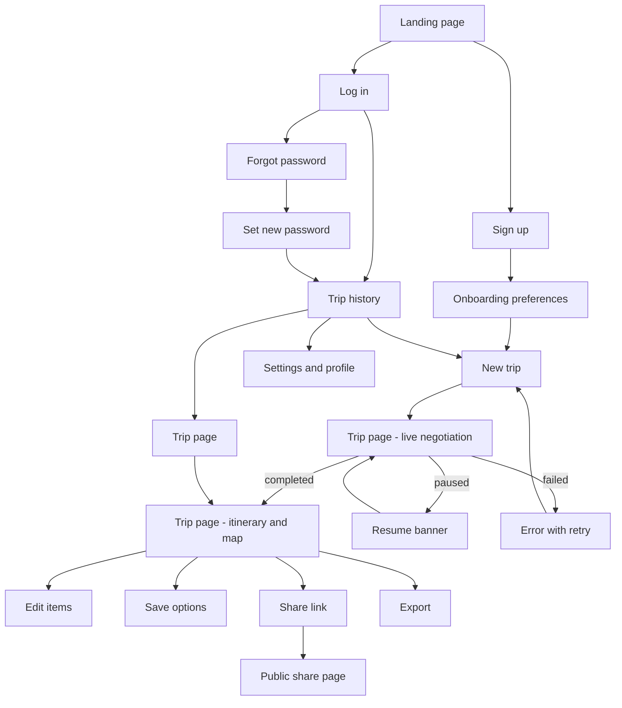

# Roamly — UX Flow

Last updated: 2026-10-02 (Phase 2). Scope follows the owner's direction: a simple, clean UI for demonstration now, visual polish later. The structure below is built so that later polish is a styling pass, not a rebuild.

---

## 1. Principles

1. **One prompt to start.** The first thing a signed-in user sees is a text box. Structured fields are optional and collapsed.
2. **The negotiation is the product.** The run view shows agents proposing, rejecting and revising in real time, with a budget meter that moves.
3. **Honest output.** Assumptions are visible. Over-budget plans say so. Paused runs say why and offer Resume.
4. **Every screen has a URL.** Refresh, back button and sharing work everywhere.
5. **Map plus list** for the itinerary, in the spirit of mindtrip.ai's clarity. Not a copy of its design.

---

## 2. Flow



The run view and the itinerary view are the same route, `/trips/[id]`. It shows the negotiation while the run is active and the itinerary when it is done, with the negotiation transcript kept in a tab.

---

## 3. Screen inventory

| # | Screen | Route | Auth | Purpose |
|---|---|---|---|---|
| 1 | Landing | `/` | public | What it is, one example, sign-up call to action |
| 2 | Sign up | `/signup` | public | Email + password, Google |
| 3 | Log in | `/login` | public | Email + password, Google |
| 4 | Forgot password | `/forgot-password` | public | Send reset email |
| 5 | Set new password | `/auth/update-password` | reset link | Complete the reset |
| 6 | Onboarding | `/onboarding` | required | Home city, currency, budget style, interests, pace. Skippable |
| 7 | New trip | `/trips/new` | required | Prompt box + optional fields |
| 8 | Trip (run / itinerary) | `/trips/[id]` | required | Live negotiation, then itinerary with map |
| 9 | Trip history | `/trips` | required | All trips with status |
| 10 | Saved | `/saved` | required | Flights, stays and places the user bookmarked |
| 11 | Settings | `/settings` | required | Profile, preferences, theme, password, sign out |
| 12 | Shared trip | `/share/[token]` | public | Read-only itinerary |
| 13 | Run debug | `/debug/runs/[id]` | required, owner | LLM and tool call timeline. For demos and viva |

Thirteen routes replace the twenty state-switched "pages" in the old app. The old Agents, Architecture, About, Flights, Accommodation, Local Recs and Budget Insights pages are folded into the trip page or dropped.

---

## 4. Screen details

### 4.1 Landing

- Headline, one-line explanation, "Plan a trip" button.
- A static three-step strip: agents propose, Budget rejects, plan converges.
- No fake statistics or testimonials.

### 4.2 Auth

- Email/password form with inline validation. "Continue with Google" button.
- After sign-up with email confirmation on: a "check your inbox" state.
- Signed-in users visiting auth pages are redirected to `/trips`.

### 4.3 Onboarding

One page, five inputs, all optional:

| Field | Control | Used for |
|---|---|---|
| Home city | Text with geocode suggestions | Default flight origin |
| Currency | Select | Default trip currency |
| Budget style | Three chips: saver, balanced, comfort | Default budget when the prompt has none |
| Interests | Multi-select chips | Activity search |
| Pace | Three chips: relaxed, balanced, packed | Activities per day |

"Skip for now" goes straight to the new-trip screen. Everything is editable later in Settings.

### 4.4 New trip

- Large prompt box with placeholder examples ("4 days in Tokyo, $2000 budget").
- "Add details" expander: origin, dates, travellers, budget and currency, interests. Values here override what the parser infers.
- Submit creates the trip and navigates to `/trips/[id]` immediately.
- Shows remaining free-model quota for today as a small hint when it is low.

### 4.5 Trip page — live negotiation (signature feature)

```
+--------------------------------------------------------------+
| Tokyo · 4 days · 1 traveller          Budget  [#######---]   |
| Round 1 of 3                          $1,950 / $2,000  OK    |
+----------------------+---------------------------------------+
| Agents               | Negotiation feed                      |
| (S) Supervisor  done | S  Parsed: Tokyo, 3 nights, USD 2000  |
| (L) Logistics   done | L  Proposing direct flight, 8h 30m    |
| (R) Recs     working | R  Proposing hotel at $320/night      |
| (B) Budget   waiting | B  REJECTED over by $460. Stay must   |
|                      |    be at or under $165/night          |
| Assumptions (2)      | S  Asking Recommendations to revise   |
|                      | R  Switched to $150/night hotel       |
|                      | B  APPROVED. Margin $50               |
+----------------------+---------------------------------------+
```

- **Agent identities:** each agent has a fixed colour, initial and one-word role. Status per agent: waiting, working, done.
- **Feed:** one card per event. Rejections and approvals are visually distinct. Proposal cards show the option (name, price, key facts). Cards appear as the SSE stream delivers them.
- **Budget meter:** total against limit, updated after every audit. Colour changes at over-budget. Category breakdown on hover or tap.
- **Round indicator:** "Round 1 of 3".
- **Assumptions panel:** everything the Supervisor guessed.
- **Model footnote:** which model served the last call and whether a fallback was used. Small, for transparency.
- When the run completes, the page switches to the itinerary view. The feed stays available under a "Negotiation" tab.

### 4.6 Trip page — itinerary

- **Header:** destination, dates, total against budget, status badge (within budget or over by X).
- **Left: day-by-day timeline.** Each day is a section with items in time order: flight, check-in, activities, meals. Each item shows time, name, cost and an "Open" link to the provider.
- **Right: Leaflet map.** Markers for every item with coordinates, a polyline per day, clustering when zoomed out. Hovering a list item highlights its marker and the reverse. A day filter narrows both.
- **Tabs:** Itinerary, Budget (breakdown table and chart, audit history), Negotiation (transcript), Options (other candidates the agents found).
- **Editing:** remove an item, swap it for another candidate from Options, move it to another day, edit the time. The total recalculates with the same calculator. If an edit pushes the plan over budget the badge changes. No re-run is triggered.
- **Actions:** Save option, Share (create or revoke link, copy), Export (print-friendly page for PDF, and markdown download).

### 4.7 Trip history

- Card or row per trip: destination, dates, budget, status (planning, ready, over budget, paused, failed).
- Search by destination. Delete with confirmation.
- Paused trips show a Resume button.

### 4.8 Settings

Profile (name, home city), preferences (same fields as onboarding), theme (light, dark, system), change password, sign out.

---

## 5. States

| Screen | Empty | Loading | Error |
|---|---|---|---|
| Trip history | "No trips yet" with a button to plan one | Skeleton rows | Inline message with retry |
| New trip | — | Button shows progress, form disabled | Validation under the field. Server error as a banner |
| Negotiation | "Waiting for the Supervisor" placeholder | Per-agent "working" indicator | **Paused:** banner with the reason and Resume. **Failed:** reason and "Try again" |
| Itinerary | Not reachable until a run completes | Skeleton timeline, map placeholder | Missing coordinates: item listed without a marker |
| Saved | "Nothing saved yet" | Skeleton | Inline retry |
| Shared trip | — | Skeleton | "This link is no longer active" |
| Auth | — | Button progress | Message under the form. Never reveals whether an email exists |

Stream handling: if the SSE connection drops, the client reconnects with the last sequence number and continues. A small "reconnecting" note appears after a few seconds.

---

## 6. Interaction notes

- Feed auto-scrolls while the user is at the bottom, and stops if they scroll up. A "jump to latest" button appears.
- The budget meter animates between values. With `prefers-reduced-motion` it changes instantly.
- Keyboard: every action reachable by Tab. Visible focus rings. Enter submits the prompt, Shift+Enter adds a line.
- Colour is never the only signal: rejections and approvals also carry a label.
- Theme follows the system by default, with the choice stored and applied before first paint to avoid a flash.

## 7. Mobile

- Single column. The agent roster collapses to a row of status dots above the feed.
- Budget meter sticks to the top.
- Itinerary: list first, with a "Map" toggle that opens the map full-height. Tapping a marker opens a bottom sheet with the item.
- Touch targets at least 44 px.

## 8. Styling approach for now

Tailwind CSS 4 (already installed) with shadcn/ui components and a small set of design tokens for colour, spacing and radius, with light and dark values. Reasons: accessible primitives out of the box, no custom CSS to maintain, and the later polish pass changes tokens and adds motion without touching structure. Deferred to that pass: GSAP scroll storytelling, 3D elements, custom illustrations, parallax.
