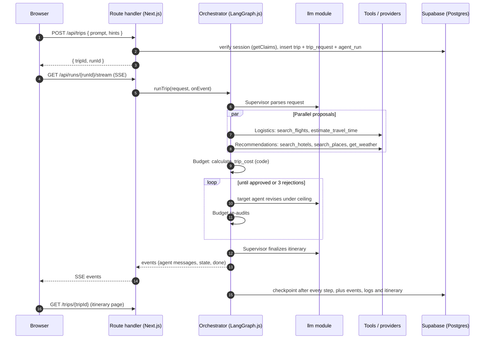
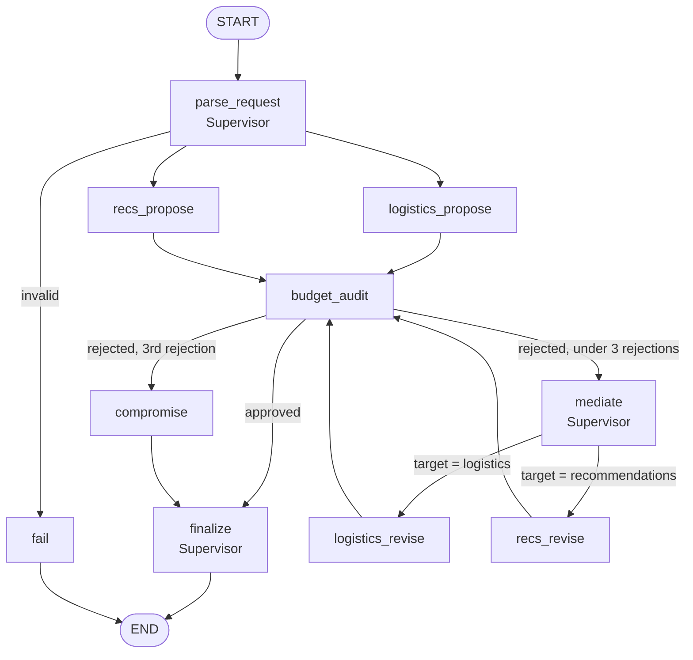

# Roamly — Technical Architecture

Last updated: 2026-10-02 (Phase 1). Version and API facts were checked on this date against npm, the official docs, and the installed packages' type definitions. See `docs/audit.md` §10 for the evidence.

---

## 0. Decisions and assumptions

From the project owner:

- Free models only. No paid credits.
- Local project, not deployed. Keep rate limiting and deployment concerns light.
- Input is a prompt first, with optional structured fields.
- Simple UI for now. Visual polish later.
- No automated test scripts for now.
- Free hand to refactor. Work on branch `aryan`.

Assumed by me where the answer was "use best practice":

| Topic | Decision |
|---|---|
| Layout | Move to `src/`. Orchestrator in `src/orchestrator/`. Project name stays Roamly. |
| Over-budget result | Show the plan, clearly marked "over budget by X", with ways to close the gap. Never labelled approved. |
| Flights in negotiation | Budget may send Logistics back for cheaper flights, not only hotels. |
| Cost categories | Flights, stay, activities, plus per-day estimates for food and local transport. |
| Currency | Trip currency comes from the prompt, else the user's profile (default INR). All prices are converted to it before any sum. |
| Old UI | Replaced with minimal real routes in Phase 3, not kept alive. |
| Supabase project | Treated as disposable: the 4 old tables are dropped by the first migration. **Say so if there is data to keep.** |
| Checkpointer | Official Postgres checkpointer, via a new server-only `SUPABASE_DB_URL`. |
| Verification | `tsc`, `eslint`, `next build`, and a manual checklist per phase. |

---

## 1. End-to-end request flow



Starting a run and streaming it are separate requests. That lets the client reconnect to a run, and lets a paused run be resumed, without re-posting the prompt.

---

## 2. LangGraph.js design

Packages: `@langchain/langgraph` 1.4.18, `@langchain/core` 1.2.14, `@langchain/openai` 1.6.2, `@langchain/langgraph-checkpoint-postgres` 1.0.5, `zod` 4.x (imported as `zod/v4`).

The graph is a hand-built `StateGraph` with fixed edges. The prebuilt `createSupervisor` is not used, because it lets an LLM choose the next agent and the spec requires deterministic routing.

### 2.1 Graph



### 2.2 Nodes

| Node | Agent | LLM calls | What it does |
|---|---|---|---|
| `parse_request` | Supervisor | 1 (`reasoning`) | Prompt + hints + profile → `request`, `assumptions`. Geocodes the destination. |
| `logistics_propose` | Logistics | ≤ 2 (`worker`) | Tool-calling turn(s), then a structured pick. Writes `flights`. |
| `recs_propose` | Recommendations | ≤ 2 (`worker`) | Same pattern. Writes `stay`, `activities`, `weather`. |
| `budget_audit` | Budget | 0–1 (`fast`) | Runs the calculator in code, sets verdict, target and ceiling. LLM only words the feedback. |
| `mediate` | Supervisor | 0 | Builds the typed instruction and routes with `Command({ update, goto })`. |
| `logistics_revise` / `recs_revise` | same agents | ≤ 2 | First tries to satisfy the ceiling from candidates already in state. Searches again only if none fit. |
| `compromise` | — | 0 | Cheapest feasible combination from all candidates seen. Sets `budget.status = "compromise"`. |
| `finalize` | Supervisor | 1 (`reasoning`) | Schedules items into days, writes JSON + markdown. Totals come from the calculator. |
| `fail` | — | 0 | Sets `status` and a user-facing `error`. |

A clean run is about 6–7 LLM requests. A worst-case run with three rejections is about 14.

### 2.3 State and reducers

`TripState` is a `StateSchema` of Zod fields (`docs/context.md` §5). `assumptions` and `audits` use a `ReducedValue` that appends. `usage` uses one that sums. All other keys are last-write-wins. The two parallel branches write disjoint keys, so no merge conflict is possible.

### 2.4 Parallel branches

`parse_request` has two outgoing edges, so `logistics_propose` and `recs_propose` run in the same super-step. `budget_audit` runs once both have finished.

### 2.5 Routing and loop breakers

- Routing out of `budget_audit` is a pure function of `budget.status` and `negotiation.rejections`.
- `negotiation.maxRejections = 3`, read from config.
- `recursionLimit` is set to 30 on every run as a backstop. `GraphRecursionError` is caught and reported as a failed run.
- A per-run request budget (default 20 LLM calls) is tracked in `usage`. When it is exhausted the graph routes to `compromise` with what it has.
- Each node has a timeout. Tool nodes use LangGraph's `retryPolicy` for transient errors.

### 2.6 Checkpointing and resume

- `PostgresSaver.fromConnString(SUPABASE_DB_URL, { schema: "langgraph" })`, with `setup()` run automatically when the server first needs it.
- `thread_id = runId`. State is saved after every step.
- **Pause:** when every model for a role is exhausted, or a tool fails after retries, the node throws a typed `ProviderExhaustedError`. The run is marked `paused` with a clear message. The last checkpoint is intact.
- **Resume:** `resumeTrip(runId, onEvent)` re-invokes the graph on the same thread with no new input. LangGraph continues from the last saved step. Completed nodes are not re-run.
- The checkpoint tables live in their own schema and are not exposed through the Supabase Data API.

### 2.7 Streaming

The orchestrator runs `graph.stream(input, { streamMode: ["updates", "custom"] })`.

- Nodes call `config.writer(event)` to emit agent messages while they work (`custom` mode).
- `updates` mode gives the state delta after each node, which drives the budget meter.

Both are mapped to one `TripEvent` union and passed to `onEvent`. The orchestrator knows nothing about SSE.

### 2.8 Isolation boundary

```
src/orchestrator/index.ts
  runTrip(request, onEvent, deps?)    → Promise<RunResult>
  resumeTrip(runId, onEvent, deps?)   → Promise<RunResult>
```

Rules: nothing under `src/orchestrator/` imports from `next/*` or from `src/app`. Persistence goes through a `RunStore` interface and travel data through provider interfaces, both passed in as `deps`. The Supabase implementations live in `src/server/`. This is what makes the orchestrator movable to a standalone Node service later.

---

## 3. Tool calling

Tools are LangChain `tool()` definitions with Zod input schemas. Each agent's model has only its own tools bound. Tool results are validated with an output schema before they enter state.

| Tool | Owner | Input (Zod) | Output | Backing provider |
|---|---|---|---|---|
| `geocode_place` | Supervisor, Logistics | `{ query: string }` | `{ name, country, lat, lng }` | `GeocodingProvider` |
| `search_flights` | Logistics | `{ origin, destination, departDate, returnDate, travellers, maxPrice? }` | `FlightOption[]` | `FlightProvider` |
| `estimate_travel_time` | Logistics | `{ from: LatLng, to: LatLng, mode }` | `{ minutes, km }` | `RoutingProvider` |
| `search_hotels` | Recommendations | `{ destination, checkIn, checkOut, guests, maxPricePerNight? }` | `HotelOption[]` | `HotelProvider` |
| `search_places` | Recommendations | `{ near: LatLng, interests[], kinds?, limit }` | `PlaceOption[]` | `PlacesProvider` |
| `get_weather` | Recommendations | `{ lat, lng, startDate, endDate }` | `DailyWeather[]` | `WeatherProvider` |
| `web_search` | Recommendations | `{ query }` | `{ title, snippet, url }[]` | `SearchProvider` |
| `convert_currency` | Budget | `{ amount, from, to }` | `{ amount, rate, asOf }` | `FxProvider` |
| `calculate_trip_cost` | Budget, Supervisor | `{ flight, stay, activities, nights, days, travellers, estimates, currency }` | `CostBreakdown` | pure function |

Common behaviour:

| Concern | Rule |
|---|---|
| Errors | Tools return a typed error result (`{ ok: false, code, message }`) instead of throwing, so the model can react. Provider outages throw and are handled by node retry. |
| Retries | 2 retries with backoff on network errors and 5xx. No retry on 4xx. |
| Timeouts | 15 s per provider call. |
| Caching | Results cached in a Supabase table keyed by tool + normalized input, with a TTL per tool (flights and hotels short, places and geocoding long). Protects free quotas and makes re-runs fast. |
| Malformed tool calls | Arguments that fail the Zod schema are sent back to the model once as a tool error. A second failure skips to the next model in the fallback list. |
| Logging | Every call writes a `tool_call_logs` row: tool, provider, latency, cache hit, error. |
| Loop cap | At most 3 tool-calling turns per agent node. |

Specific providers are chosen in Phase 5 (`docs/api_research.md`). The interfaces above are fixed now so that work is a wiring job.

---

## 4. LLM routing and fallback

One module, `src/orchestrator/llm/`. Agents call `getModel(role, { tools })` and nothing else.

### 4.1 Providers

| Tier | Provider | How | Notes (verified 2026-10-02) |
|---|---|---|---|
| 1 | OpenRouter, `:free` models | `ChatOpenAI` with `configuration.baseURL = https://openrouter.ai/api/v1`; `modelKwargs` carries `models` and `provider` | 20 requests/min, 50 requests/day without credits. Remaining quota at `GET /api/v1/key`. |
| 2 | NVIDIA hosted endpoint | `ChatOpenAI` with `baseURL = https://integrate.api.nvidia.com/v1` | `nvidia/nemotron-3-ultra-550b-a55b`, tool calling and `enable_thinking`. Limits not published. |

With 50 OpenRouter requests a day, tier 2 is not just an emergency path. It will carry real traffic once the daily cap is reached, so it gets the same care as tier 1.

### 4.2 Model registry

`config/models.json`, not code. Initial contents, from the OpenRouter models API filtered to free + tool-calling on 2026-10-02:

| Role | Used by | Ordered models |
|---|---|---|
| `reasoning` | Supervisor parse, finalize | `nvidia/nemotron-3-super-120b-a12b:free` → `qwen/qwen3.8-27b:free` → `google/gemma-4-31b-it:free` → NVIDIA `nemotron-3-ultra-550b-a55b` (thinking on) |
| `worker` | Logistics, Recommendations | `qwen/qwen3.8-27b:free` → `google/gemma-4-31b-it:free` → `nvidia/nemotron-3-super-120b-a12b:free` → NVIDIA `nemotron-3-ultra-550b-a55b` (thinking off) |
| `fast` | Budget wording | `google/gemma-4-26b-a4b-it:free` → `liquid/lfm-2.5-2.6b:free` → NVIDIA `nemotron-3-ultra-550b-a55b` (thinking off) |

Free model lists rotate without notice. The registry is the only place to edit, and `npm run models:check` pings each configured model with a tiny tool-calling request and reports dead ones. The same check runs lazily on first use and drops failures for the life of the process.

### 4.3 Wiring order

```
for each tier:
  model = new ChatOpenAI({...})           // build
  bound = model.bindTools(tools)          // bind tools first
chain = tier1.withFallbacks({ fallbacks: [tier2] })   // then wrap
```

The fallback wrapper has no `bindTools`, so tools must be bound before wrapping. Inside tier 1, OpenRouter's own `models` array handles model-to-model fallback in a single request (rate limit, downtime, context or moderation errors), with `provider.require_parameters = true` so only tool-capable providers are used. Tier 1 → tier 2 fallback is LangChain's `withFallbacks`.

### 4.4 Limits, kept simple

- One small in-process token bucket per provider, shared by all agents, set under the provider cap (LangChain JS has no built-in rate limiter).
- 429 → respect `Retry-After`, back off, retry twice, then fall through to the next tier.
- Requests per provider per day are counted in `provider_quota_usage`. When OpenRouter's remaining count is low, new calls go straight to tier 2.
- When both tiers fail, the run pauses with: "All free models are busy or out of quota. Your progress is saved. Resume later."

### 4.5 Guards

Recursion limit 30, max 3 rejections, 20 LLM calls per run, 60 s per LLM call, 3 tool turns per node.

### 4.6 Structured output

Agent picks and the final itinerary are produced with `withStructuredOutput(zodSchema)` where the model supports it, otherwise JSON mode plus Zod parse. A parse failure is retried once with the validation error included, then the node's deterministic fallback is used and flagged in the event stream.

---

## 5. External APIs and MCP

Chosen in Phase 5 after research. Until then these are candidates, not commitments:

| Category | Candidates to evaluate |
|---|---|
| Flights | Amadeus Self-Service, Duffel, Travelpayouts/Aviasales, Kiwi Tequila |
| Hotels | Amadeus hotels, Hotellook/Travelpayouts, others |
| Places | OpenTripMap, Geoapify, Overpass/OSM, Foursquare |
| Web context | Tavily |
| Maps | Leaflet + `react-leaflet`; OSM tiles or MapTiler/Stadia |
| Geocoding / routing | Nominatim or Geoapify; OpenRouteService or OSRM |
| Weather | Open-Meteo |
| FX | A free daily-rates API |
| MCP | Calendar, email, export. Via `@langchain/mcp-adapters` 2.0.0 |

Working assumption: real booking is out of reach on a student budget, so the design is search + price + deep link.

Action tools (calendar, email, share link, PDF) are never called by an agent on its own. They run only from an explicit user click, server-side, scoped to that user.

---

## 6. Data layer

Supabase Postgres. Schema as SQL migrations in `supabase/migrations/`. TypeScript types generated from the schema. Full detail lands in `docs/database.md` in Phase 3.

| Group | Tables |
|---|---|
| Identity | `profiles`, `user_preferences` |
| Trips | `trips`, `trip_requests` |
| Runs | `agent_runs`, `agent_messages`, `budget_audits`, plus LangGraph checkpoint tables in schema `langgraph` |
| Output | `itineraries`, `itinerary_days`, `itinerary_items`, `saved_options` |
| Sharing | `shared_trips` |
| Observability | `llm_call_logs`, `tool_call_logs`, `provider_quota_usage` |
| Infrastructure | `tool_cache` |

**RLS strategy.** RLS on every table in `public`. Owner tables: `user_id = auth.uid()`. Child tables: ownership through the parent trip. Shared trips: readable through a server route that checks the share token, not through a public policy. Log, quota and cache tables: no client policies at all; written and read only by the server with the service-role client. A trigger creates the profile and default preferences on signup.

**What is persisted when.**

| Moment | Written |
|---|---|
| Trip created | `trips`, `trip_requests`, `agent_runs` (status `running`) |
| Every graph step | checkpoint |
| Every agent event | `agent_messages` (ordered by `seq`) |
| Every LLM / tool call | `llm_call_logs` / `tool_call_logs`, quota counter |
| Every audit | `budget_audits` |
| Run ends | `itineraries` + days + items, `agent_runs.status`, `trips.status` |

---

## 7. Auth and API layer

### 7.1 Auth

`@supabase/ssr` 0.12.7 with cookie sessions.

- Three clients in `src/lib/supabase/`: `client.ts` (browser), `server.ts` (server components and route handlers), `admin.ts` (service role, marked `server-only`).
- `src/proxy.ts` refreshes the session and redirects signed-out users away from app routes. In Next 16 this file replaces `middleware.ts`.
- Server code authorizes with `getClaims()`, which verifies the token. `getSession()` is never trusted on the server.
- Email/password and Google OAuth, with `/auth/callback` for the code exchange and `/auth/update-password` for resets.
- Keys: `NEXT_PUBLIC_SUPABASE_URL`, `NEXT_PUBLIC_SUPABASE_PUBLISHABLE_KEY`. `SUPABASE_SERVICE_ROLE_KEY` and `SUPABASE_DB_URL` are server-only and never prefixed `NEXT_PUBLIC_`.

### 7.2 Routes

| Route | Method | Purpose |
|---|---|---|
| `/api/trips` | POST | Validate body (Zod), create trip + run, return ids |
| `/api/trips` | GET | List the user's trips |
| `/api/trips/[id]` | GET, PATCH, DELETE | Read, edit itinerary items, soft-delete |
| `/api/runs/[id]/stream` | GET | SSE. Replays stored events, then runs or resumes the graph and streams live |
| `/api/runs/[id]/resume` | POST | Mark a paused run for resume |
| `/api/trips/[id]/share` | POST, DELETE | Create or revoke a share link |
| `/api/profile`, `/api/preferences` | GET, PUT | Account data |
| `/api/saved` | GET, POST, DELETE | Saved options |

Every handler does three things: authenticate, validate, call a function in `src/server/` or the orchestrator. No business logic in handlers.

### 7.3 SSE contract

```
event: agent     { seq, agent, kind: "proposal"|"rejection"|"revision"|"approval"|"info", round, text, data }
event: state     { seq, budget: { total, limit, status }, round, rejections }
event: usage     { llmCalls, toolCalls, model, fallbackDepth }
event: done      { tripId, status }
event: paused    { code, message }
event: error     { code, message }
```

`seq` increases per run. On reconnect the client sends the last `seq` it saw and receives only newer events.

---

## 8. Observability

Every LLM call writes one `llm_call_logs` row: run, agent, role, provider, requested model, served model, fallback depth, prompt and completion tokens, latency, status, error code, and cost (0 for free models, kept for when that changes). Every tool call writes one `tool_call_logs` row. A small `/debug/runs/[id]` page shows the timeline for a run. Server logs are structured JSON lines with `runId` on every line. Secrets and full prompts are never logged.

---

## 9. Tech stack

| Layer | Choice | Version |
|---|---|---|
| Framework | Next.js, App Router | 16.3.x |
| UI runtime | React | 19.2.x |
| Language | TypeScript, strict | 5.x |
| Orchestration | `@langchain/langgraph` | 1.4.18 |
| LangChain core / OpenAI client | `@langchain/core`, `@langchain/openai` | 1.2.14 / 1.6.2 |
| Checkpointer | `@langchain/langgraph-checkpoint-postgres` | 1.0.5 |
| Schemas | `zod` | 4.x |
| Database / auth | Supabase: `@supabase/supabase-js`, `@supabase/ssr` | 2.117.x / 0.12.7 |
| Styling | Tailwind CSS (already installed) + shadcn/ui components | 4.x |
| Maps | Leaflet + `react-leaflet` | confirmed in Phase 5 |
| Removed | `@google/generative-ai`, direct Mistral calls, `framer-motion`, all mock data | — |

## 10. Folder structure after refactor

```
config/
  models.json                 role → ordered model list
docs/
supabase/
  migrations/                 numbered SQL files
src/
  proxy.ts                    session refresh + route protection
  app/
    (marketing)/page.tsx      landing
    (auth)/login, signup, forgot-password
    auth/callback/route.ts, auth/update-password/page.tsx
    (app)/trips/page.tsx              history
    (app)/trips/new/page.tsx          prompt + optional fields
    (app)/trips/[id]/page.tsx         negotiation view → itinerary + map
    (app)/settings/page.tsx
    share/[token]/page.tsx
    api/…                     route handlers (§7.2)
  orchestrator/               no Next.js imports
    index.ts                  runTrip, resumeTrip
    state.ts                  Zod TripState
    graph.ts                  nodes, edges, compile
    events.ts                 TripEvent types
    ports.ts                  RunStore + provider interfaces
    agents/                   supervisor, logistics, recommendations, budget
    prompts/
    tools/                    Zod-typed tools, calculator
    llm/                      registry, providers, fallback, limiter, logging
    providers/                concrete API adapters (Phase 5)
  server/                     Supabase RunStore, queries, SSE helper
  lib/supabase/               client, server, admin
  components/
  types/database.ts           generated
```

**Migration from the current code.** Port `lib/agents/math.ts` into `tools/calculator.ts` with the fixes from `docs/audit.md` §7. Reuse the prompts as a starting point. Delete `lib/mockData.ts`, `lib/tools/catalog.ts`, `lib/agents/gemini.ts`, `context/AppContext.tsx` and the old `components/` once the replacements exist.

---

## 11. Local development

```
npm install
cp .env.example .env          # fill in keys
npm run db:migrate            # apply supabase/migrations to the project
npm run db:types              # regenerate src/types/database.ts
npm run models:check          # optional: verify configured free models respond
npm run dev
```

Required to run: Supabase URL, publishable key, service-role key, DB connection string, `OPENROUTER_API_KEY`. `NVIDIA_API_KEY` is strongly recommended because of the 50/day OpenRouter cap. Travel API keys are added in Phase 5.

## 12. Deployment note

Not planned. Three constraints are respected so it stays possible: no state on the local filesystem, all persistence in Supabase, and runs that resume from checkpoints instead of depending on one long HTTP request. If it is ever deployed, serverless function time limits are the main issue, and the orchestrator can move to a small standalone Node service without changes because it does not depend on Next.js.
